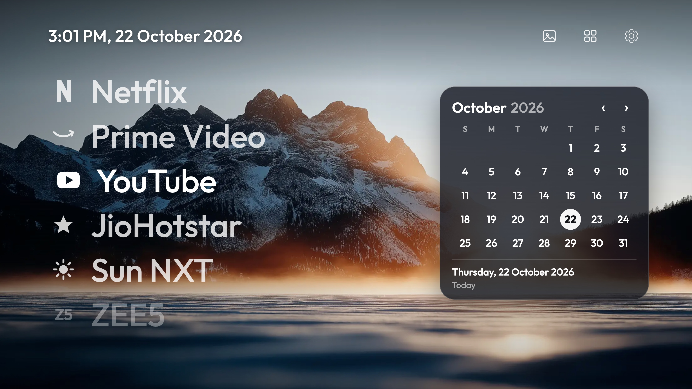
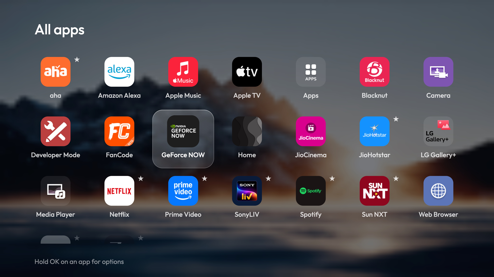
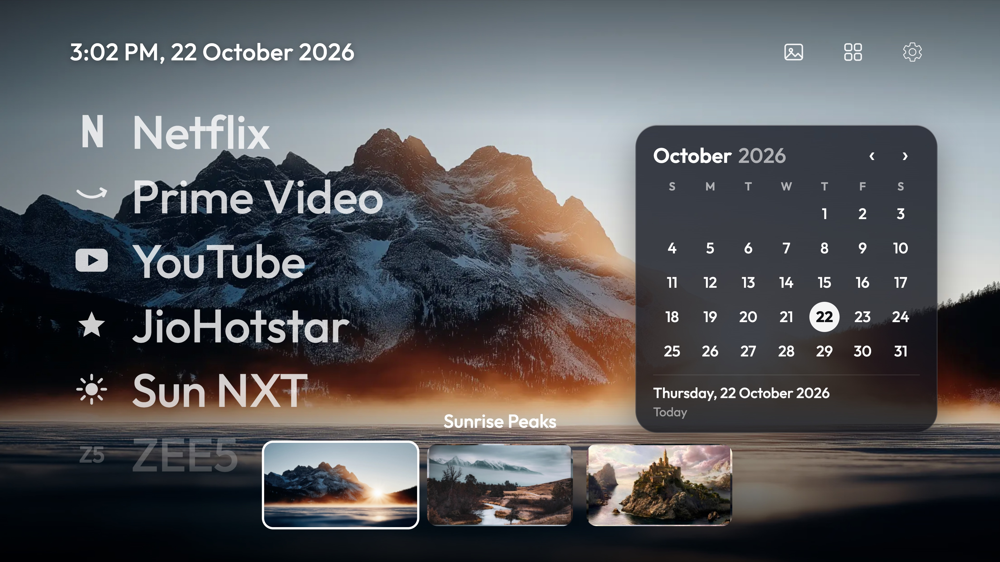

# TV Redesign

A minimalist, Apple TV-inspired home screen for LG webOS TVs. It runs as a normal Developer Mode app: **no root, no firmware changes, and LG's own home screen stays untouched underneath.**

Designed and built by [KNMNikhil](https://github.com/KNMNikhil).

<p align="center">
  
</p>
<p align="center">
  
  
</p>

## Features

- **Big, calm app list.** Your favourites in large type over a full-screen wallpaper. Six rows show at a time and the list scrolls smoothly; the edge rows fade out.
- **All apps.** A grid of everything installed, with a glass highlight that glides between tiles over a softly blurred wallpaper. Hold OK on an app to add it to the home list, move it, or hide it.
- **Wallpaper picker.** Preview and choose from your own images with the remote.
- **Month calendar.** A small glass card you can move around with the remote, with month switching and a footer that tells you how far away the highlighted day is.
- **Idle screen.** After a while without a key press the screen dims and shows a large clock that drifts slowly, so nothing stays lit in one place.
- **Settings menu.** Wi-Fi status and networks, HDMI inputs and Live TV, TV settings, and a switch for showing hidden apps.
- **Pointer remote support.** Hover and click work everywhere, without hover stealing focus while a list scrolls.
- **Fast on TV hardware.** No live blur or mask effects. Animations only move or fade whole layers, and the blurred background is a tiny pre-blurred copy of the wallpaper.

## Compatibility

- LG TVs running **webOS 26** with **Developer Mode** available.
- Built and tested on a single LG OLED TV. Other models and webOS versions may work but are untested.
- Needs a computer on the same network as the TV (macOS for the wallpaper helper script; the rest is plain Python and Node.js).

## What it does not do

- It does not replace LG's home screen at system level. The Home button still opens LG's home first. An optional watcher script (`scripts/home_watch.py`) switches to this launcher about half a second later, but it needs a device that stays on. Without it, open the launcher from the Apps list or assign it to a remote number key.
- It does not remove LG's own promotions or personalised ads. Those can be switched off in the TV's own settings (Home Promotion, Content Recommendation, Viewing Information, Interest-Based Advertising).
- It cannot change LG's built-in screen saver. The launcher has its own idle clock screen, which appears before the TV's screen saver does.

## Setup

See [docs/SETUP.md](docs/SETUP.md) for the full walkthrough. In short:

```bash
scripts/setup-tools.sh                         # pinned tools, installed inside this folder only
# put your TV in Developer Mode and register it, as described in docs/SETUP.md
scripts/make-wallpapers.sh a.png b.png c.png   # your own wallpapers (optional)
TV_HOST=<TV_IP> ./install.sh                   # sync apps, package and install
```

## Configuration

Everything you would want to change is in [`app/config.js`](app/config.js): the apps on the home list, apps hidden from All apps, shorter display names, idle delay, first day of the week, and the wallpaper list. Run `./install.sh` again after editing.

## Make it your own

This project is meant to be changed. The quick edits (apps, hidden apps, names, wallpapers, idle delay) are all in [`app/config.js`](app/config.js). For bigger changes, such as a different layout, other colours, new widgets or another look for the highlight, you can open the project folder in [Claude Code](https://claude.com/claude-code) and describe what you want in plain words, for example *"move the calendar to the left"* or *"add a notes card under the calendar"*. Claude Code can edit the files, preview the result and reinstall it on your TV with `./install.sh`.

A few habits keep your setup safe while you do:

- Review the changes before running `./install.sh`.
- Keep your TV's IP address, passphrase and `.tv-key.json` out of anything you commit or share. They are already git-ignored.
- To go back to a clean state at any time, remove the launcher from the TV (see [docs/SETUP.md](docs/SETUP.md)). LG's own home screen is never modified.

## Remote controls

| Where | Keys |
|---|---|
| Home list | Up / Down move, OK opens, Right goes to the calendar, Up from the first row goes to the top icons |
| Top icons | Left / Right move, OK opens wallpaper picker, All apps or Settings, Down goes to the calendar |
| Calendar | Arrows move across dates, Up from the first row reaches the month header (OK on the arrows changes month), Left from the first column returns to the list |
| All apps | Arrows move, OK opens, **hold OK** for options, Back closes |
| Wallpaper picker | Left / Right preview, OK keeps, Back cancels |

## Safety

- Runs as a sandboxed Developer Mode app. Remove it with one command and LG's home screen is exactly as before.
- Pairing with the TV asks for five permissions only: launch apps, see the foreground app, list installed apps and inputs. It cannot change settings, power or inputs.
- Scripts refuse anything that is not a private network address, and download app icons only from the TV itself.
- The pairing key is stored in `.tv-key.json` with owner-only permissions and is git-ignored, as are the app list and icons generated from your TV.
- Tooling is version-pinned and installed inside the project folder; nothing runs at install time that was not pinned beforehand.

## Project layout

```
app/            the launcher itself (HTML, CSS, JavaScript)
scripts/        pairing, app sync, optional Home-button watcher, wallpaper and icon helpers
docs/           setup guide and screenshots
install.sh      sync, package and install on the TV
```

## Credits

- Outfit typeface by The Outfit Project Authors, SIL Open Font License 1.1 (`app/fonts/OFL.txt`).
- The pairing and install approach for Developer Mode apps follows the open-source *webos-vibehack* project (MIT); its notice is kept in [LICENSE](LICENSE).
- App names and logos belong to their respective owners. The simple marks on the home list are drawn for this project.

## License

MIT, see [LICENSE](LICENSE).
